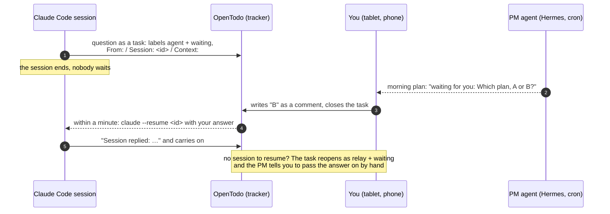

<p align="center"></p>

# bryhadyr

**A foreman for you and your AI agents: one task tracker, one protocol, one project manager that nags, and a way to answer an agent by closing a task.**

You run several Claude Code sessions a day (cloud, server, laptop), a Telegram agent, maybe a tablet on the desk.
Every session finds work that somebody has to do later, and forgets to write it down. Worse, a session that needs *your* decision either
blocks on the chat or asks in a final answer that is gone tomorrow.
`bryhadyr` (Ukrainian *бригадир*, the foreman of a work crew) fixes that with parts that already exist, a protocol, and a few small scripts.

## The loop: the agent asks, you close a task, the session continues



Everything on that path is a file, a label or a cron line you can read. [How the answer gets back →](docs/07-session-replies.md)

## What is in the box

| Part | What it is |
|------|-----------|
| **Tracker** | [OpenTodo](https://github.com/OpenTodoApp/OpenTodo): self-hosted, one Go binary, SQLite, ≈ 20 MB RAM, a real web app with Kanban, a built-in **MCP** endpoint and two-way **Obsidian** sync, by Raffaele Pizzari ([support him](#support-the-opentodo-author)) |
| **Protocol** | One Markdown file every agent reads at session start: projects are topics, task states, what a good task looks like, how to close a big task with a verified summary, how to ask you a question ([plugin/PROTOCOL.md](plugin/PROTOCOL.md), [uk](plugin/PROTOCOL.uk.md)) |
| **Hooks** | Three small shell scripts: put the protocol and the session id into the context; remind **once** to close a big task; refuse a task that does not say where it came from |
| **Session replies** | `stack/task_replies.py`: a timer that delivers your comment on a closed question-task to the session that asked |
| **Notes in the tracker** | `stack/notes_mirror.py`: a timer that shows selected Obsidian notes inside OpenTodo, linked with their tasks |
| **Tidying up** | Two skills and read-only audit tools that clean up sessions, worktrees and the vault: look, plan, act after you agree, verify. [docs/09-tidying.md](docs/09-tidying.md) |
| **Main chat per direction** | One chat per direction talks, plans and checks; the work goes to child sessions the chat starts itself, with a brief that begins "Worker session:". A `HANDOFF.md` per folder is the direction's memory; `scripts/install_global_md.py` puts the standing instruction and your table of directions into `~/.claude/CLAUDE.md`. [docs/10-main-chat.md](docs/10-main-chat.md) |
| **Project manager** | [Hermes Agent](https://github.com/NousResearch/hermes-agent) cron jobs on Claude: morning plan, silent midday ping, evening report, weekly review with hygiene. It sorts what the agents dumped, proposes deadlines, nags you in Telegram |
| **Distribution** | A Claude Code plugin + committed templates (cloud sessions), a Hermes SOUL block (Telegram), project instructions (claude.ai). Change the file, push, everyone follows |

```
 you (phone, tablet on the desk, Obsidian)        AI agents (Claude Code cloud · server · laptop, claude.ai, Hermes)
            │ web app / Obsidian Tasks files                        │ MCP «tasks» + the protocol + 3 hooks
            └──────────────────────►  OpenTodo  ◄───────────────────┘
                                       ▲    │  ▲
                 notes_mirror.py ──────┘    │  └── Hermes PM (cron on Claude): plan · ping · report · weekly hygiene → Telegram
                 (Obsidian notes → Notes)   └────► task_replies.py: your closing comment → `claude --resume <session>`
```

## Task states

OpenTodo has no status field, so the protocol builds states out of labels and built-in features. Nothing here needs a plugin.

| State | How it is marked | Who sets it |
|-------|------------------|-------------|
| Queue | an open task without state labels | anyone |
| Doing | label `doing` (at most 3 in the whole tracker; removed at the finish) | the agent that works on it |
| Waits for you | label `waiting`, a `Session:` line in the description | the agent that asked |
| Pass on by hand | labels `relay` + `waiting` | `task_replies.py`, when your answer could not be delivered |
| Blocked | `blocked_by` (a task) or the label `blocked` + the reason | anyone |
| Someday | `start: "someday"`: out of the working lists | you, or the PM after your "ok" |
| Done | `complete_tasks` + a six-line summary comment | whoever *verified* the result by running it |
| Won't do | `complete_tasks` + a comment "Cancelled: why" | you |

Quality rules that matter more than the states: a task says where it came from (`From:`), has a check that can be run (`Done when:`), carries
the history it needs (`Context:`), and an agent's comment on an open task starts with "Agent:". The tracker holds only what somebody will
pick up within two weeks; a bulk list goes into one file in the repository and at most 5 tasks. [Full rules →](plugin/PROTOCOL.md)

## Quick start (about an hour)

1. **Tracker:** `stack/` → `docker compose up -d`, create the owner account, enable *AI assistants* and create an `agent` token. [docs/01-opentodo.md](docs/01-opentodo.md)
2. **MCP for agents:** local Claude Code (`claude mcp add -s user`), cloud sessions (`.mcp.json` + environment secrets), claude.ai (custom connector over a public path). [docs/02-mcp.md](docs/02-mcp.md)
3. **Protocol and hooks everywhere:** `claude plugin marketplace add <you>/bryhadyr`, `claude plugin install bryhadyr@bryhadyr`; `scripts/sync.sh <repo>` for repos that run in the cloud. [docs/05-protocol.md](docs/05-protocol.md)
4. **Obsidian:** `ot vault init <vault>/OpenTodo` on the server, or the OpenTodo Obsidian plugin on your devices. [docs/03-obsidian.md](docs/03-obsidian.md)
5. **Project manager:** `hermes/install.sh` adds the SOUL block, the MCP server and four cron jobs. [docs/04-pm-agent.md](docs/04-pm-agent.md)
6. **Answers back into sessions** (optional): `scripts/install-timers.sh replies`. [docs/07-session-replies.md](docs/07-session-replies.md)
7. **Notes inside the tracker** (optional): copy `stack/notes-rules.example.json`, `scripts/install-timers.sh notes`. [docs/08-notes-in-opentodo.md](docs/08-notes-in-opentodo.md)
8. **Fill the tracker once:** the harvest prompt, one file and at most five tasks per project. [docs/06-harvest.md](docs/06-harvest.md)

## Why polling and not a webhook

OpenTodo can call a webhook on task completion, and the answer would be instant. The loop above still polls once a minute, on purpose:
a webhook to a machine on a private network is refused unless the protection is switched off for the whole server, it needs a full-scope
token and an always-on authenticated receiver, and a missed call is lost. The poll needs none of that, is idempotent (it re-reads the last ten minutes and
remembers what it handled), and a stopped timer or a reboot is simply caught up on the next tick. The price is up to a minute of latency, which for
a question that waited for hours is noise. [Details →](docs/07-session-replies.md#why-polling-and-not-a-webhook)

## What it costs

| Item | Cost |
|------|------|
| Tracker | ≈ 20 MB RAM idle; no licence cost (AGPL-3.0) |
| PM agent (Hermes, Sonnet 5.5 for three jobs, Haiku 5.5 for the midday ping) | ≈ 10–20 USD a month in API credits; none if you run it on your default Hermes model instead ([the arithmetic](docs/04-pm-agent.md#cost)) |
| Protocol in every session | ≈ 3k tokens of context at session start (English file), cached after the first turn |
| Hooks | no tokens. The Stop hook blocks at most once per session, which costs one extra turn when it fires |
| Session replies | no tokens to poll (one `list_tasks` a minute). Each delivered answer is one more turn of that session over its whole context, as if you had typed it |
| Notes mirror | no tokens; a few requests per changed note every 15 minutes |

These are the numbers of one setup, not a promise. Watch the API console for the first month.

## Limitations, said plainly

- **Replies reach only sessions on the machine that runs the timer.** Cloud sessions and sessions on another computer cannot be resumed from here;
  their answers fall back to `relay` and a reminder from the PM.
- **A session that is open in an app is only a reminder.** If the session is open right now (in a Claude app, or a terminal over SSH),
  resuming it a second time would fork its transcript, so the script does not: the task reopens as `relay` and you paste the answer in.
- **The API does not tell who wrote a comment.** The tracker shows the same account for you and for an agent's token. Closing is attributed through the
  operation log, but a *comment's* author is guessed from its first words, hence the prefix "Agent:" for every agent comment on an open task.
- **`obsidian://` links are stripped** from note text in OpenTodo. A mirrored note prints its plain path and the task chip is the clickable way back.
- **A note is at most 20 000 characters in OpenTodo;** the mirror cuts at 19 000 and says so.
- **Hooks are heuristics.** The Stop hook counts edit tools and commits in the transcript; it does not see `sed -i`. The task check reads text lines, not meaning.
- **One person's setup.** The states, labels and rhythm are opinionated; the PM prompts assume Telegram and Hermes. Everything that differs per
  installation is a variable or a config file, but expect to edit the protocol to your taste.
- **Built against OpenTodo 0.22**; its tool names and fields (`blocked_by`, `start: "someday"`, `sector`, `origin`) may change.

## Repository layout

| Path | What |
|------|------|
| `plugin/` | the Claude Code plugin: `PROTOCOL.md` (+ `.uk.md`), the skill, the three hooks and their tests; `.claude-plugin/marketplace.json` at the root makes this repo a marketplace. It registers no MCP server (see [docs/05-protocol.md](docs/05-protocol.md)) |
| `templates/` | what to commit into a repo whose sessions run in the cloud (`.claude/settings.json`, `.mcp.json`), and the task and note templates |
| `hermes/` | SOUL block, config fragment (MCP + model aliases), four cron prompts (English and Ukrainian), `install.sh` |
| `stack/` | OpenTodo `docker-compose.yml`, `.env.example`; `notes_mirror.py`, `task_replies.py`, their rules example, systemd units and tests |
| `scripts/` | `sync.sh` (copy the plugin into a repo), `install-timers.sh`, `check.sh` (validate everything), `harvest-prompt.md` |
| `docs/` | setup guides, costs, the reasoning |
| `examples/` | a finished Obsidian note and a task summary, as agents produce them |

## Support the OpenTodo author

`bryhadyr` is a thin layer; the heavy lifting is OpenTodo by **Raffaele Pizzari** ([@pixari](https://github.com/pixari)), AGPL-3.0, actively developed.
If this setup saves you a subscription, send some of it his way: [GitHub Sponsors](https://github.com/sponsors/pixari) · [Buy Me a Coffee](https://buymeacoffee.com/pixari).
As he puts it: using it, sharing it or reporting a bug helps just as much.

## Status and credits

Built in November 2026 for one home server (a NUC with 3.7 GB of RAM, Debian, Tailscale) by [@atamanml](https://github.com/atamanml) with Claude.
Everything here is what actually runs there, generalised. Issues and PRs welcome, in English or Ukrainian. MIT.
