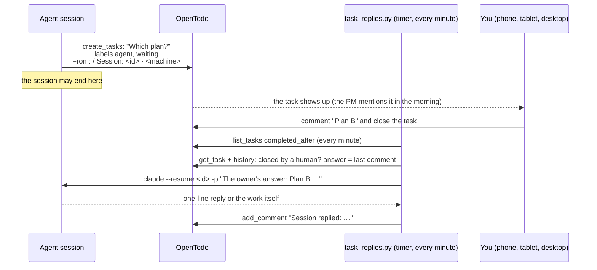

# 7 · Answering a session from the tracker

A long agent session reaches a fork only you can decide ("which of the two plans?", "may I delete the old table?"). Waiting in the chat
means keeping a window open; asking in the final answer means the question is gone tomorrow. This guide is the third way: the agent files a
**question as a task**, you answer by **closing the task with a comment**, and the answer arrives **in the session that asked**, a minute later.



## What the agent does

Protocol §3a. The task carries four lines in its description; the hooks enforce the first two (`plugin/hooks/task-check.sh` refuses
`create_tasks` without `From:`, and a `waiting` task without `Session:`):

```
From: <your task or request this question grew out of>
Session: <session id> · <machine>
Context: <what follows from each answer, 2–6 lines>
Done when: the owner has answered
```

The session id comes from the SessionStart hook (it reads `session_id` from the hook input and adds a ready-to-paste line to the context).
Labels: `agent`, `waiting`. An agent comment on the open task starts with "Agent:" so that it is not mistaken for your answer.

## What you do

Close the task. Three ways, three outcomes:

| You close it … | What happens |
|----------------|--------------|
| **with a comment** | within a minute the comment is delivered to the session as a message from you; the task gets "Passed to session …", later "Session replied: …" |
| **without a comment**, or with a comment that starts with `-`, `—` or `–` | nothing is sent: the dash is the way to leave yourself a note |
| the task was closed by an agent | ignored (the operation log says who closed it) |

The delivered message tells the session that the answer covers this question only and permits nothing else; a reply that calls for an action is
carried out under the permission mode the session had.

## When it cannot be delivered

The script reopens the task with the labels `relay` and `waiting` and a comment "Not delivered: <reason>. The owner's answer: …". Reasons:

- the session is **not on the machine** that runs the timer (a session on your laptop, in the cloud, or one that was deleted);
- the session is **open right now** (a process with its id is alive; a second process on the same transcript would fork it);
- `claude --resume` failed or timed out (30 minutes).

The PM agent then lists the task every morning and evening in its own block "Pass to the session": title, session id, your answer. You paste
the answer into the session by hand and close the task again; closing a `relay` task means "passed on by hand" and clears the labels.

## Install

On the machine where the sessions live (the one with `~/.claude/projects/`):

```bash
# stack/.env needs OPENTODO_BASE_URL and OPENTODO_AGENT_TOKEN (the «agent» token the agents use; no full-scope token is needed)
scripts/install-timers.sh replies         # user systemd timer: bryhadyr-task-replies.timer, every minute
python3 stack/task_replies.py poll --dry-run    # report what it would do, change nothing
journalctl --user -u bryhadyr-task-replies.service -n 20
```

Settings (environment, or `~/.config/bryhadyr/env` for the unit): `OPENTODO_LOCAL_URL` (default `http://127.0.0.1:8080`),
`BRYHADYR_LANG=uk` for the Ukrainian text of what the script writes. The first run only remembers the time: what was closed before is history.

## Why polling and not a webhook

OpenTodo can call a webhook when a task is completed, and that would be instant. It costs more than it saves here:

- A webhook to a machine on a private network (localhost, a tailnet address) is refused unless OpenTodo's private-network protection is
  switched off **for the whole server**, and creating a webhook needs a token with full scope.
- A receiver must be an always-on HTTP service with its own authentication, reachable from the container: one more thing to run, secure and monitor.
- A missed webhook is lost unless you build retries. The poll is idempotent: every run re-reads the last ten minutes of completions
  and a `seen` map removes the repeats, so a stopped timer, a reboot or a failed run is caught up on the next tick.

The price is up to a minute of latency and one cheap request a minute (an empty poll is a single `list_tasks`). For answers to
questions that waited for hours, a minute is noise.

## Limits, honestly

- **Only sessions on the server.** `claude --resume` needs the transcript file under `~/.claude/projects/` of the machine that runs the timer.
  Cloud sessions and sessions on another computer go to `relay`.
- **A session open in the app is only a reminder.** If you have the session open in a Claude app (or in a terminal over SSH), its process is
  alive, the script will not resume it a second time, and the answer goes to `relay`. The same goes for a session that is still running.
- **The author of a comment is invisible to the API.** The tools show the same account for you and for an agent token. The script tells who
  *closed* the task from the operation log (`device: agent:…` vs. yours), and who *wrote* the last comment from its prefix: hence "Agent:".
  An answer that happens to start with "Agent:", "Done:" or "Cancelled:" is not delivered.
- **The permission mode is inherited from the session**, with `bypassPermissions` mapped to `auto`; a session that asked in `plan` mode answers in `plan` mode.
- **One answer per task.** Only the newest comment is delivered. A follow-up question is a new task.
- **At most about a minute of delay,** and the rate limit of OpenTodo's writes (30 a minute) applies; the script waits it out.
